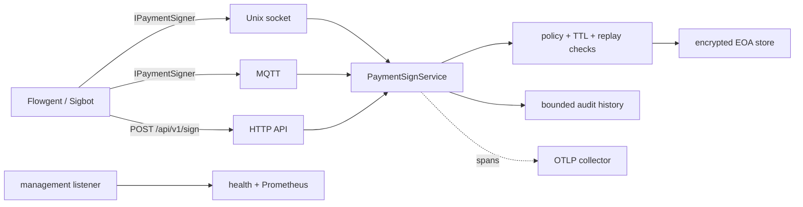

# AgentVault

AgentVault is a process-isolated Rust service for EOA wallet custody and
payment signing. Flowgent, Sigbot, and other agent runtimes submit a stable
`PaymentSignRequest`; they never load or decrypt private keys.



## What is included

- Wallet CRUD at `/api/v1/wallet`; update atomically rotates the private key.
- Direct signing and searchable history at `/api/v1/sign`.
- Public `IPaymentSigner::execute` interface with `LocalPaymentSigner` and
  `MqttPaymentSigner` implementations for external agent runtimes.
- Unix-socket and MQTT server endpoints using the same JSON contract.
- XChaCha20-Poly1305 encrypted key records, HKDF-wrapped data key, owner-only
  files, process-exclusive store locking, bounded request TTL, policy checks,
  and idempotent request IDs.
- A separate management listener with liveness, readiness, OpenMetrics, and
  optional OTLP/gRPC trace export.
- A real-process E2E under `use-cases/payment-signing/e2e`.

The signing audit log deliberately excludes private keys, digest bytes, and
signatures. It records request identity, bounded routing metadata, outcome, and
timestamps only.

## Build and verify

Rust `1.91.1` is pinned by `rust-toolchain.toml`.

```bash
make fmt-check
make lint
make test
make e2e
make build
# or run the complete gate
make verify
```

`make e2e` starts a real `walletd` child process, exercises HTTP plus the Unix
socket, verifies the recoverable EOA signature, queries history, and inspects
Prometheus output. No middleware or secret token is needed for this loopback
test.

## Configure and run

The canonical configuration is [`etc/agentvault.yaml`](etc/agentvault.yaml).
Built-in defaults are overlaid by that YAML and then by `AGENTVAULT__...`
environment variables:

```bash
export AGENTVAULT__LOGGING__LEVEL=debug
export AGENTVAULT__MGMT__OTEL__ENABLED=true
```

Provision and start a local instance:

```bash
install -d -m 0700 ./data ./run ./secrets
walletd master-key generate --output ./secrets/master.key

# Copy etc/agentvault.yaml to a local YAML and point store/master-key/socket
# paths at the directories above.
walletd --config ./agentvault.local.yaml wallet generate payer
walletd --config ./agentvault.local.yaml serve
```

The HTTP API may run without a token only on a loopback address. A non-loopback
binding requires `server.api_token_file`, an owner-only file containing the raw
bearer token. MQTT deployments must additionally enforce broker TLS,
authentication, and per-client topic ACLs.

Private-key import remains an offline CLI operation so key material is never
placed in an HTTP or MQTT request:

```bash
walletd --config ./agentvault.local.yaml wallet import payer \
  --private-key-file ./secrets/payer.hex
```

## API and SDK contract

The main endpoints are:

| Method | Path | Purpose |
|---|---|---|
| `POST` | `/api/v1/wallet` | Generate a wallet |
| `GET` | `/api/v1/wallet` | List wallets |
| `GET` | `/api/v1/wallet/{id}` | Read public wallet metadata |
| `PUT` | `/api/v1/wallet/{id}` | Rotate the wallet key atomically |
| `DELETE` | `/api/v1/wallet/{id}` | Delete a wallet |
| `POST` | `/api/v1/sign` | Sign one validated payment digest |
| `GET` | `/api/v1/sign` | Search signing history |
| `GET` | `/api/v1/sign/{request_id}` | Read the latest matching audit event |

Agent projects should depend on `model::sign::PaymentSignRequest` and the
`IPaymentSigner` trait rather than transport internals. The contract carries a
precomputed 32-byte EIP-712 digest as base64 and returns a 65-byte Ethereum
`r || s || v` signature as hex (`v` is 27 or 28).

See [API reference](docs/api.md), [architecture](docs/architecture/overview.md),
and [observability](docs/observability.md).

## Security boundary

- AgentVault owns key generation/import, encrypted storage, request validation,
  EOA address derivation, and digest signing.
- Calling agents own payment policy, x402 payload creation, EIP-712 hashing,
  and the signed-resource retry.
- Raw-message and arbitrary-transaction signing are intentionally unsupported.
- One process owns one encrypted store. Replicas need independently provisioned
  stores with equivalent logical wallet identities.
- These controls do not protect a compromised host, broker, or operator account.
