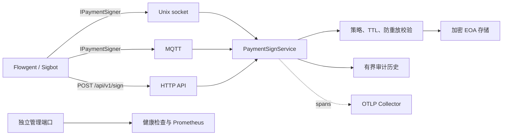

# AgentVault

AgentVault 是一个用 Rust 编写、进程隔离的 EOA 钱包托管与支付签名服务。
Flowgent、Sigbot 等 agent 运行时只提交稳定的 `PaymentSignRequest`，不会加载或
解密私钥。



## 已实现能力

- `/api/v1/wallet` 钱包 CRUD；更新操作会原子轮换私钥。
- `/api/v1/sign` 直接签名、历史列表与组合搜索。
- 面向外部 agent 的 `IPaymentSigner::execute` 接口，以及
  `LocalPaymentSigner`、`MqttPaymentSigner` 两种实现。
- Unix socket 与 MQTT 服务端共享同一份 JSON 协议模型。
- XChaCha20-Poly1305 密钥加密、HKDF 数据密钥封装、owner-only 文件、存储
  进程锁、TTL/授权策略校验与幂等 request ID。
- 独立管理端口提供 liveness、readiness、OpenMetrics，并可通过 OTLP/gRPC
  导出 trace。
- `use-cases/payment-signing/e2e` 中包含真实子进程 E2E，不使用 handler/store
  mock。

签名历史刻意不保存私钥、digest 或签名，只保存请求标识、有限路由元数据、
结果和时间戳。

## 构建与验证

项目通过 `rust-toolchain.toml` 固定 Rust `1.91.1`：

```bash
make fmt-check
make lint
make test
make e2e
make build
# 完整验收
make verify
```

`make e2e` 会启动真实 `walletd` 子进程，经 HTTP 和 Unix socket 完成钱包管理
与签名，恢复验证 EOA 地址，并检查历史和 Prometheus 指标。

## 配置与启动

唯一标准配置是 [`etc/agentvault.yaml`](etc/agentvault.yaml)。加载优先级为
内置默认值 < YAML < `AGENTVAULT__...` 环境变量：

```bash
export AGENTVAULT__LOGGING__LEVEL=debug
export AGENTVAULT__MGMT__OTEL__ENABLED=true
```

本地运行示例：

```bash
install -d -m 0700 ./data ./run ./secrets
walletd master-key generate --output ./secrets/master.key

# 复制 etc/agentvault.yaml，并将 store/master-key/socket 改成本地路径。
walletd --config ./agentvault.local.yaml wallet generate payer
walletd --config ./agentvault.local.yaml serve
```

HTTP API 只有绑定 loopback 时才允许不配置 token；绑定非 loopback 地址时，
必须设置 `server.api_token_file`，该 owner-only 文件中保存原始 bearer token。
MQTT 生产环境还必须启用 broker TLS、认证和按 client 隔离的 topic ACL。

私钥导入仍是离线 CLI 操作，避免把私钥放进 HTTP/MQTT 请求：

```bash
walletd --config ./agentvault.local.yaml wallet import payer \
  --private-key-file ./secrets/payer.hex
```

## API 与 SDK 契约

| 方法 | 路径 | 用途 |
|---|---|---|
| `POST` | `/api/v1/wallet` | 生成钱包 |
| `GET` | `/api/v1/wallet` | 查询钱包列表 |
| `GET` | `/api/v1/wallet/{id}` | 查询公开钱包元数据 |
| `PUT` | `/api/v1/wallet/{id}` | 原子轮换钱包密钥 |
| `DELETE` | `/api/v1/wallet/{id}` | 删除钱包 |
| `POST` | `/api/v1/sign` | 校验并签署支付 digest |
| `GET` | `/api/v1/sign` | 搜索签名历史 |
| `GET` | `/api/v1/sign/{request_id}` | 查询该请求最新审计事件 |

Flowgent/Sigbot 应依赖 `model::sign::PaymentSignRequest` 与 `IPaymentSigner`，不要
依赖传输实现内部。请求传输 base64 编码的 32 字节 EIP-712 digest，成功响应
返回十六进制 65 字节 Ethereum `r || s || v` 签名，其中 `v` 为 27 或 28。

更多内容见 [API 文档](docs/api_ZH.md)、
[架构说明](docs/architecture/overview_ZH.md) 和
[可观测性](docs/observability_ZH.md)。

## 安全边界

- AgentVault 负责密钥生成/导入、加密存储、请求校验、地址派生与 digest 签名。
- 调用方负责支付策略、x402 payload、EIP-712 hash 及签名后的资源重试。
- 明确不支持原始消息签名和任意交易签名。
- 一个进程独占一个加密 store；多副本需分别安全配置等价的逻辑钱包。
- 这些机制无法抵御已失陷的宿主机、broker 或运维账号。
