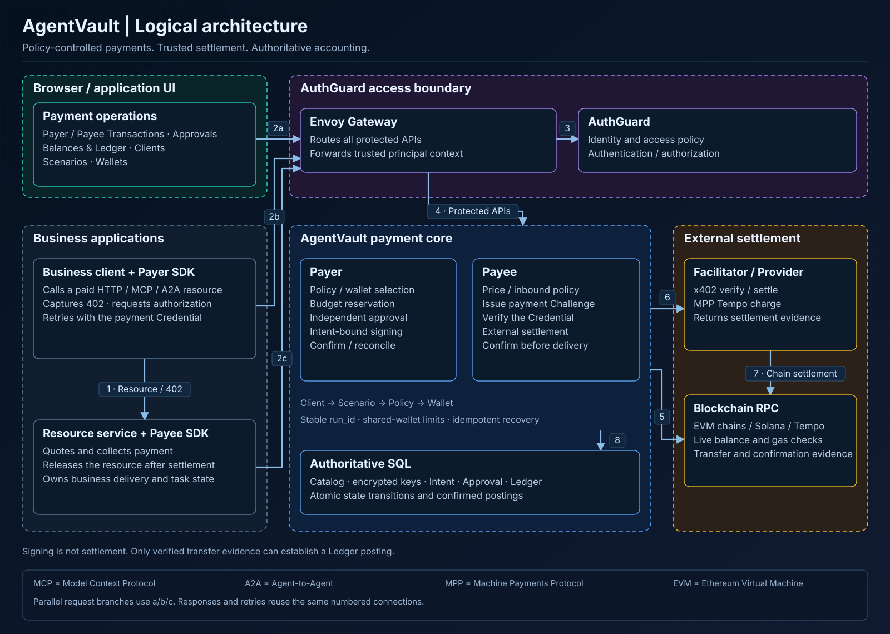
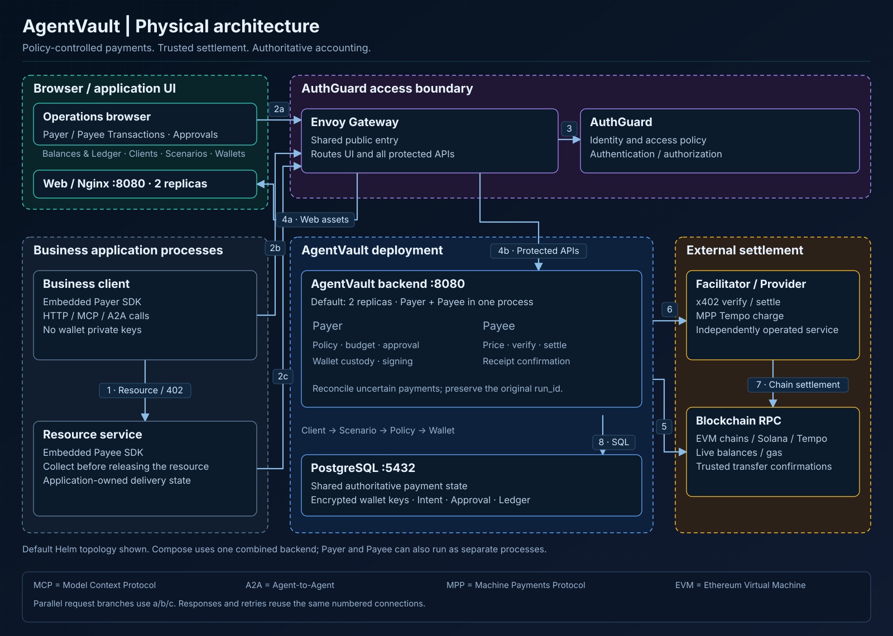

# AgentVault Payment Authorization and Settlement Architecture

| Document metadata | Value |
|---|---|
| Status | Architecture Reference |
| Document version | 1.0 |
| Updated | 2026-11-17 |
| Type | Architecture / Interface Specification |
| Scope | Payment authorization, custody, settlement, accounting, and deployment boundaries |
| Implementation baseline | Repository runtime at `246c241`; this publication changes documentation only |
| Companion | [中文](AgentVault-Payment-Architecture-Whitepaper_ZH.md) |

Contents: [Abstract](#abstract) · [Motivation](#motivation) · [Specification](#specification) · [Rationale](#rationale) · [Backwards Compatibility](#backwards-compatibility) · [Reference Implementation](#reference-implementation) · [Security Considerations](#security-considerations) · [Test Cases](#test-cases) · [References](#references)

## Abstract

AgentVault is bidirectional payment infrastructure for AI-agent applications. It separates application delivery from payment authorization and confirmation. A Payer SDK obtains constrained payment authority without holding wallet private keys. A Payee SDK prevents paid resource delivery until settlement is confirmed. AgentVault persists the resulting authorization, payment, approval, and accounting facts in SQL.

The architecture combines a shared AuthGuard access boundary, independently enabled Payer/Payee roles, operator-selected settlement adapters, and a durable transaction model. Identity authorization, a payment signature, external settlement, and business delivery are distinct outcomes. The design requires each outcome to be established by its owning authority.

## Motivation

A business agent may request an HTTP API, MCP tool, or supported A2A operation that returns a payment Challenge. Giving that application a wallet private key would combine application compromise, spending authority, and unrestricted signing. Treating a merchant response as proof of transfer would also allow accounting to diverge from settlement.

AgentVault centralizes wallet use behind persisted Scenario/Policy rules while preserving application ownership of resources and tasks. The same architecture supports inbound collection: pricing, Credential validation, settlement, and delivery admission remain separate from the business handler. SQL transactions and recovery evidence are required because an external chain transfer and a local database commit cannot be atomic together.

## Specification

### 1. Scope and requirement language

MUST and MUST NOT identify required correctness or security properties. SHOULD identifies a recommended deployment practice; MAY identifies an explicitly supported option. These terms define the contract, while [Reference Implementation](#reference-implementation) identifies its implemented scope and extension points.

The scope is the AgentVault payment boundary and its application SDKs. Identity-provider implementation, chain consensus, the external Facilitator/Provider, application task storage, and business fulfillment remain outside that boundary. AgentVault does not provide arbitrary-digest signing or a second application workflow engine.

### 2. Authorities and domain model

| Authority / component | Responsibility | Required boundary |
|---|---|---|
| AuthGuard + Envoy Gateway | Identity and access policy; shared routing for protected APIs | AgentVault MUST consume trusted principal context rather than accept caller-asserted identity. |
| Business client + Payer SDK | Request resource, preserve the business Run, obtain authorization, retry with Credential, report payment response | The SDK MUST NOT hold payment-wallet private keys or choose signing Wallet/Policy/amount/recipient. |
| Resource service + Payee SDK | Obtain Price/Challenge, request verification/settlement, gate delivery | The application MUST retain its own task/delivery state and MUST NOT release a paid resource solely because a Credential exists. |
| AgentVault Payer | Ownership, deterministic wallet selection, reservation, approval, live-funds checks, constrained signing, outbound confirmation | Signing MUST remain bound to the persisted Intent and eligible active key version. |
| AgentVault Payee | Pricing, Challenge binding, Credential checks, external settlement, inbound confirmation | Payee MUST use public wallet metadata rather than Payer custody to settle an incoming payment. |
| Authoritative SQL | Durable configuration, budgets, approval consumption, payment state, accounting, recovery | Cache, logs, and client responses MUST NOT establish financial authority. |
| External settlement services | Provider verification/settlement and independently queried chain facts | Endpoints and supported assets MUST come from operator configuration, not an untrusted Challenge. |

| Domain concept | Contract |
|---|---|
| Client | Registered application bound to a trusted `auth_principal`. |
| Scenario | One Client's payment isolation boundary; registration alone grants no spending authority. |
| Policy | Explicit protocol/network/asset/origin/recipient restrictions, directional limits, and approval rules. |
| Wallet membership | A Policy authorizes one or more Wallets; shared wallets retain aggregate hard limits. |
| Price | Authoritative receiving-side quote bound to Scenario, inbound Policy, and eligible receiving Wallet. |
| Intent | Durable selected authority, request fingerprint, payment state, reservation, and recovery progress. |
| Challenge / Credential / Receipt | Bound request for payment / constrained payment proof / protocol result; none alone replaces trusted settlement evidence. |
| Ledger | Append-only confirmed financial effects and exact reversals. |

The ownership graph is **Client → Scenario → Policy → Wallet membership**. The caller supplies `scenario_id + run_id + original challenge`; the trusted principal establishes Client ownership. Amount, asset, network, recipient, and protocol facts are derived from the Challenge and validated against persisted configuration.

### 3. Logical topology and payment sequence

The logical view is a time-ordered walkthrough. Steps 1–3 show the shared protected access path. The SDK-to-AgentVault messages in steps 5, 7, 12, and 18 traverse that path and repeat its access checks; direct logical connectors do not denote an identity bypass. The example uses one deployment for both payment roles, without requiring that deployment arrangement.

#### 3.1 Numbered calls and state effects

| Step | Call and result | State effect / ordering |
|---|---|---|
| 1 | Administration UI calls the shared protected entry. | Supported configuration, approval, and wallet operations enter the payment-domain boundary. |
| 2 | Gateway obtains the AuthGuard access decision. | Trusted principal context is established for the request. |
| 3 | Gateway routes the authorized administration request. | Catalog changes use domain transactions; financial history remains read-only. |
| 4 | Business client requests a resource without payment. | The resource handler does not execute the paid operation. |
| 5 | Payee SDK resolves Price and obtains a bound Challenge. | Payee validates inbound scope and persists Challenge/capacity facts. This step groups Price resolution and Challenge issuance, not a new combined API. |
| 6 | Resource service returns `402` and the Challenge. | The original resource operation is still unpaid. |
| 7 | Payer SDK sends Scenario, stable Run, and original Challenge to AgentVault. | Caller-selected Wallet/Policy/payment projections are rejected. |
| 8 | Payer validates membership, selects Wallet, and creates the durable authorization. | Reserve budget atomically, or persist a pending Approval and pause. A permitted independent decision precedes grant consumption and reservation. |
| 9 | Payer checks live chain balance and gas. | These checks MUST succeed before signing; operational balance snapshots are insufficient. |
| 10 | AgentVault returns the Intent-bound Credential. | The active key signs the constrained protocol plan. No private key is returned. A signature is not settlement. |
| 11 | Payer SDK retries the same resource request with Credential. | The logical `run_id` and original request binding remain stable. |
| 12 | Payee SDK requests verification and settlement of the paid request. | Verification and settlement are distinct supported API operations, grouped here as one logical phase. |
| 13 | AgentVault Payee invokes the configured external Provider. | Protocol checks and idempotent Provider operations precede confirmed accounting. |
| 14 | Provider returns trusted transfer evidence. | Chain, asset, decimals, amount, recipient, effect, and confirmations are validated. Uncertain evidence enters recovery, not success. |
| 15 | Payee commits the INBOUND settlement and Ledger effect. | Intent, Event, Ledger, and Outbox changes share one SQL transaction. |
| 16 | Payee returns a confirmed Receipt to the resource service. | The resource service may now admit the paid operation. |
| 17 | Resource service delivers its result and payment response. | Application delivery is idempotent. Its failure after payment does not justify charging again. |
| 18 | Payer SDK reports the protocol payment response. | The response is a verification input, not authority to create a Ledger entry. |
| 19 | Payer independently confirms the transfer through configured receipt observation. | The original Intent's transfer binding is checked against trusted chain facts. |
| 20 | Payer commits the OUTBOUND payment and Ledger effect. | The payer's own accounting closes only after confirmation. |

An initial Challenge exchange and a Credential-bearing retry are different passes through the resource endpoint. Budget reservation occurs before signing; inbound confirmation occurs before delivery; outbound accounting occurs after independent confirmation. Replies are drawn explicitly where they define these protocol boundaries.

#### 3.2 Public interface groups

Paths below are relative to the default `/api/v1` business API root. They are protected business/admin routes, not private management-listener routes.

| Logical phase | HTTP interface |
|---|---|
| Price / Challenge | `POST /prices/resolve`; `POST /payee/challenges` |
| Payer authorization | `POST /payments/authorize`; `GET /payments/{intent_id}`; `GET /payments/{intent_id}/receipt` |
| Approval | `GET /approvals`; `POST /approvals/{approval_id}/decision` |
| Inbound verification / settlement | `POST /payee/verify`; `POST /payee/settle` |
| Outbound evidence report | `POST /payments/{intent_id}/outbound-response` |
| Operational views / configuration | `/admin/payments`, `/admin/ledger`, `/admin/clients`, `/admin/scenarios`, `/admin/wallets`, `/admin/prices` with their supported methods |

Strongly typed SDK DTOs and contract fixtures define the wire boundary. The numbered phases do not add routes, combine distinct endpoints, or introduce another public idempotency field.

### 4. Authorization, selection, and approval

`run_id` identifies one logical business operation, not an authorization subject. `UNIQUE(scenario_id, run_id)` MUST return the existing result for an equal request fingerprint and MUST reject a changed request. Polling, approval, paid retry, evidence reporting, reconciliation, and application delivery preserve that Run. `attempt_no` may increase; trace identity is observability metadata, not a replacement business key.

Candidate selection is bounded. Eligible Policy–Wallet memberships are grouped as directly authorized, approval-required, or rejected. Within an eligible group, lower daily spent-plus-reserved use is preferred, with a stable request-hash tie-break. Matching Policies are alternative grants, not an implicit intersection. Membership, lifecycle, key version, snapshot, and both Scenario and shared-Wallet budgets MUST be rechecked under SQL locks. An existing Intent MUST NOT silently move to another Wallet on retry.

Inbound and outbound limits are independent within the Policy budget unit. Shared-wallet hard limits aggregate exposure across Scenarios. An Approval MUST authorize only one Intent, retain the original Run, bind the request fingerprint and amount, expire, and be consumed once in the reservation transaction. The requester MUST NOT approve their own payment. Approval MUST NOT rewrite persistent Policy or bypass Wallet hard limits.

### 5. Durable state, accounting, and recovery

| State class | States / meaning |
|---|---|
| Authorization | `created`, `pending_approval`, `authorized` retain the chosen business and authorization identity. |
| Payment execution | `signed`, `submitted`, `pending_settlement` are progress states, not confirmed funds. |
| Uncertain outcome | `unknown` remains subject to evidence-based reconciliation. |
| Terminal outcome | `settled`, `failed`, `expired`; transitions follow the domain rules and available evidence. |

SQL is the authority for these transitions. PostgreSQL uses ordered row locks, conditional updates, and transaction leases; SQLite uses `BEGIN IMMEDIATE` with a single AgentVault writer process. Ledger entries MUST be append-only; correction uses exact reversal. `(wallet_id, posting_key)` deduplicates a financial effect, while trusted `effect_ref` distinguishes principal, fees, refunds, and other effects of a transaction.

External settlement cannot be rolled back by a failed local commit. The runtime MUST preserve recovery-critical evidence, repeat external operations idempotently where supported, and reconcile uncertain outcomes rather than manufacture success. Recovery MUST read exact `(intent_id, event_type, attempt_no)` evidence, not infer authority from a paginated event view. Each process uses a unique SQL lease owner.

| SQL aggregates / supporting records | Purpose |
|---|---|
| `pay_client`, `pay_scenario`, `pay_policy`, `pay_price` | Persisted authority and quote configuration. |
| `pay_wallet`, `wallet_key_version`, `pay_policy_wallet` | Wallet identity, encrypted key versions, hard limits, membership. |
| `pay_scenario_approver`, `pay_approval` | Independent approvers and one-use decisions. |
| `pay_intent`, `pay_event`, `pay_ledger` | Payment progress, durable evidence, confirmed accounting. |
| `pay_outbox` | Aggregate-committed delivery/recovery records. |
| `pay_wallet_balance`, `pay_schema_version` | Operational observations and controlled schema history. |

Static DDL constraints enforce relationships and uniqueness. Financial decisions MUST remain explicit domain transactions rather than hidden business triggers or unrelated generic CRUD calls. Catalog pagination serves display, not membership authorization. Direct arbitrary SQL writes bypass the supported application boundary.

### 6. Custody and protocol scope

Managed wallet private keys are encrypted in SQL key versions using the configured custody key ring. Only Payer opens the custody interface for constrained signing; Payee consumes public wallet metadata. Active key version, authorization, live funds, and required gas MUST be rechecked before signature. API, SDK, console, and UI MUST NOT export plaintext private keys or offer arbitrary-digest signing.

Browser wallet import is a secp256k1 flow: a short-lived identity-bound RSA session supplies a public key; Web Crypto encrypts the private key before submission. The server atomically consumes the session, decrypts transiently, and delegates to existing encrypted custody. Private-key plaintext MUST NOT enter React state, URLs, logs, or JSON requests. Authentic page/key delivery still requires HTTPS.

| Supported profile | Boundary |
|---|---|
| x402 v2 / EVM | Exact token payment with constrained EIP-3009 authorization. |
| x402 v2 / Solana | Configured SPL-token exact-payment profile and receipt checks. |
| MPP / Tempo | Constrained `charge` transactions and configured external settlement. |
| HTTP / MCP | Protocol Challenge, Credential, paid retry, Receipt handling. |
| A2A | Explicitly enabled non-streaming A2A 0.3 `message/send` using each payment protocol's own extension contract. |

MPP session/split/fee sponsorship/machine-token/delegated-key modes, automatic streaming A2A, A2A 1.0, and nested AP2 are outside the implemented automatic-payment profile. Unsupported or conflicting wire data MUST be rejected. Provider authorities, supported assets, and RPC endpoints are operator-selected; untrusted Challenge data MUST NOT override them. Payment Credentials MUST NOT follow a cross-origin redirect or overwrite unrelated business authentication.

### 7. Deployment and management boundaries

The physical view describes service placement and its own numbered deployment connections; the complete protocol order is defined by the logical view and its 1–20 table. Default Helm deployment uses separate Web replicas, two combined-role backend replicas, and shared PostgreSQL. `serve --role payer` and `serve --role payee` MAY separate the roles without changing contracts. Compose defaults to one combined backend. SQLite is a single-process alternative, not a shared replica database.

Gateway routes the UI and registered protected business/admin APIs. AuthGuard MAY be explicitly disabled for an isolated trusted network; this opens the HTTP identity boundary but MUST NOT disable payment-domain checks. Production TLS and private database/custody access remain operator responsibilities. Management health/metrics/diagnostics use the private management listener, not catalog/payment write APIs.

Cache, Secret projection, and observability support the deployment but do not establish financial authority. Configured external infrastructure may replace bundled services through the documented deployment switches. These concerns remain in the deployment guides rather than separate payment-architecture components.

## Rationale

- **Separate identity and spending authority.** An authenticated request still needs Scenario ownership, Policy, Wallet, budget, approval, and signing checks.
- **Separate signature, settlement, and delivery.** Each has a different authority and recovery path; conflating them creates duplicate charging or false accounting.
- **Place financial concurrency in SQL.** Shared-wallet reservations, grant consumption, accounting, and leases require an atomic durable boundary across replicas.
- **Keep keys outside business applications.** Constrained authorization reduces the authority exposed by a compromised client or arbitrary signing request.
- **Retain application ownership.** AgentVault does not introduce a second task database or fulfillment state machine into A2A/MCP applications.

## Backwards Compatibility

This whitepaper publication changes neither runtime APIs nor schema or deployment defaults. SDKs use the existing HTTP contracts and typed DTOs. Business gRPC/MQTT transports and caller-selected signing projections are not part of the current contract. AuthGuard's internal identity integration and telemetry transport are separate infrastructure concerns.

Existing `run_id`, request fingerprint, wallet/key identity, and directional accounting facts MUST retain their meaning through retries and upgrades. Operators follow versioned schema migration and deployment procedures rather than modifying historical Ledger or encrypted key material directly.

## Reference Implementation

| Implemented responsibility | Source reference |
|---|---|
| Payer authorization, approval, signing, evidence | [`src/payer/`](../../src/payer/) |
| Payee Challenge, verification, settlement | [`src/payee/`](../../src/payee/) |
| Shared domain models, SQL ports, custody, recovery | [`src/core/`](../../src/core/) |
| Protocol and chain receipt adapters | [`src/protocol/`](../../src/protocol/) |
| Role composition and scheduled reconciliation/expiry/balance sync | [`src/cmd/`](../../src/cmd/) |
| Application middleware and native client/server adapters | [`src/sdk/`](../../src/sdk/) |
| Administration UI | [`web/`](../../web/) |

The runtime baseline implements the boundaries described above. Outbox rows and `PaymentEventDispatcher`/`PaymentEventSink` are explicit delivery extension points; the default CLI does not run a push-notification dispatcher. Application A2A/MCP servers, task stores, and delivery semantics remain application-owned. Operational balance snapshots are non-authoritative and do not replace pre-sign live checks.

## Security Considerations

1. Strip forged identity/context at the access boundary and validate trusted principal binding before payment authority is evaluated.
2. Bind Challenge/Credential to Scenario, request, asset, network, recipient, amount, nonce, and expiry; reject replay or changed fingerprint.
3. Apply budget reservation, independent approval, and active-key checks in the required transaction/order before signing.
4. Validate external evidence before both inbound and outbound Ledger commits. A timeout or unverifiable result is not success.
5. Scope database/custody credentials to the runtime; authenticate provider endpoints and enforce response/time/redirect bounds.
6. Protect immutable history and private keys; Secret, cache, logs, and telemetry MUST NOT become alternative funds authorities.
7. Preserve the paid Run when delivery fails, and separate any new payment operation from retry of already confirmed fulfillment.

## Test Cases

| Conformance case | Required observable result |
|---|---|
| Same Run / same fingerprint; changed fingerprint | Replay returns the original operation; a changed request conflicts. |
| Concurrent Scenarios sharing a Wallet | Atomic reservations and hard limits prevent aggregate overspend. |
| Approval pause/resume or unauthorized/self approval | Only a permitted independent one-use decision resumes the original Intent. |
| Retired key, insufficient live balance/gas, or forged signing input | Fail closed before signature; no silent Wallet switch. |
| Provider timeout / uncertain transfer / local commit failure | Persisted evidence and leases converge without duplicate accounting. |
| Inbound payment followed by failed business delivery | Confirmed payment remains valid; delivery retries without a second charge. |
| Outbound merchant response without matching chain evidence | No confirmed outbound Ledger entry is created. |
| Real SDK and browser journeys | SQL, chain effects, selected wallets, receipts, and rendered UI agree. |

The [MarketPulse verifier](../../use-cases/marketpulse-feed-subscription/README.md) runs a 25-combination full HTTP matrix or four Rust/Go combinations. Docker/Kubernetes CI also loads the production Web image and exercises live APIs with screenshots and SQL assertions. Dedicated Solana, Tempo, and A2A scenarios establish their own protocol evidence; passing one profile does not establish all profiles. Fixture-driven presentation checks are distinguished from live financial verification.

## References

- [Architecture overview](overview.md) and [Chinese companion](AgentVault-Payment-Architecture-Whitepaper_ZH.md).
- [Payer routes](../../src/payer/src/routes/api.rs), [Payee routes](../../src/payee/src/routes/api.rs), and [SDK contract](../../src/sdk/README.md).
- [SQL migrations](../../migrations/) and [storage interfaces](../../src/core/src/storage/).
- [Docker deployment](../../deploy/docker/README.md) and [Helm/bootstrap guide](../../deploy/helm/agentvault/README.md).
- [End-to-end scenarios and evidence](../../use-cases/marketpulse-feed-subscription/README.md).
