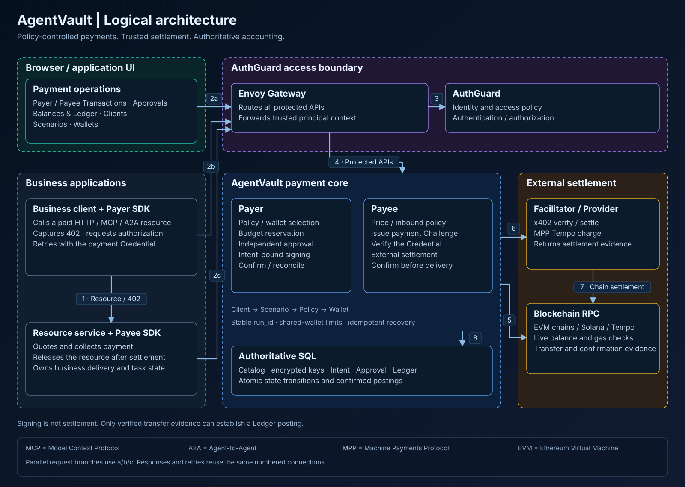
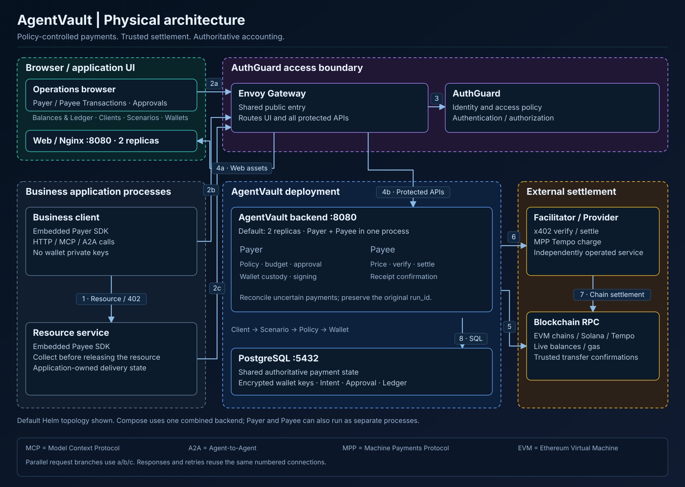

# AgentVault 支付授权与结算架构规范

| 文档元数据 | 内容 |
|---|---|
| 状态 | 架构参考 |
| 文档版本 | 1.0 |
| 更新日期 | 2026-11-17 |
| 类型 | 架构 / 接口规范 |
| 范围 | 支付授权、托管、结算、会计记录与部署边界 |
| 实现基线 | 仓库运行时代码 `246c241`；本次发布只修改文档 |
| 对照版本 | [English](AgentVault-Payment-Architecture-Whitepaper.md) |

目录：[摘要](#abstract) · [设计动机](#motivation) · [规范](#specification) · [设计依据](#rationale) · [兼容性](#backwards-compatibility) · [参考实现](#reference-implementation) · [安全考虑](#security-considerations) · [符合性用例](#test-cases) · [参考资料](#references)

## Abstract（摘要）

AgentVault 是面向 AI-agent 应用的双向支付基础设施，将业务交付与支付授权、确认分开。Payer SDK 在不持有钱包私钥的情况下取得受约束付款能力；Payee SDK 在结算确认前阻止付费资源交付。AgentVault 将授权、支付、审批和会计事实持久化到 SQL。

本架构由共享 AuthGuard 访问边界、独立启用的 Payer/Payee 角色、运营方选择的结算适配器和持久事务模型组成。身份授权、支付签名、外部结算、业务交付是不同结果，分别由对应权威建立。

## Motivation（设计动机）

业务 Agent 调用 HTTP API、MCP Tool 或受支持的 A2A 操作时，资源端可能返回支付 Challenge。如果业务应用直接持有私钥，应用失陷将同时暴露资金与不受约束的签名能力；如果仅按商户响应认定到账，会计记录也可能偏离真实转账。

AgentVault 将钱包使用收敛到持久 Scenario/Policy 规则之后，同时保留应用对资源和任务的所有权。入站收款同样将定价、Credential 验证、结算及交付准入与业务 Handler 分离。外部链上转账不能与本地数据库共同原子提交，因此必须使用 SQL 事务和恢复证据收敛不确定结果。

## Specification（规范）

### 1. 范围与规范用语

MUST、MUST NOT 表示正确性或安全性的强制要求；SHOULD 表示推荐部署实践；MAY 表示明确支持的选项。这些用语定义契约，[参考实现](#reference-implementation) 列出实现范围与扩展点。

范围是 AgentVault 支付边界与应用 SDK。身份提供方的实现、链共识、外部 Facilitator/Provider、应用任务存储和业务履约不属于此边界。AgentVault 不提供任意 Digest 签名，也不另建业务工作流引擎。

### 2. 权威与领域模型

| 权威 / 组件 | 职责 | 必须保持的边界 |
|---|---|---|
| AuthGuard + Envoy Gateway | 身份与访问策略，统一路由 protected APIs | AgentVault MUST 消费可信 Principal 上下文，不接受调用方自报身份。 |
| 业务客户端 + Payer SDK | 请求资源、保留业务 Run、取得授权、携 Credential 重试、上报支付响应 | SDK MUST NOT 持有支付钱包私钥，也不能为签名选择 Wallet/Policy/金额/收款人。 |
| 资源服务 + Payee SDK | 取得 Price/Challenge、申请验证/结算、控制交付 | 应用 MUST 保留自身任务/交付状态，MUST NOT 仅因存在 Credential 就放行付费资源。 |
| AgentVault Payer | 归属、确定性钱包选择、预留、审批、实时资金检查、受约束签名和付款确认 | 签名 MUST 绑定持久 Intent 和合规 Active Key Version。 |
| AgentVault Payee | 定价、Challenge 绑定、Credential 校验、外部结算与收款确认 | Payee MUST 使用公开钱包元数据，不使用 Payer 托管私钥完成入站结算。 |
| 权威 SQL | 持久配置、预算、审批消费、支付状态、会计与恢复 | 缓存、日志、客户端响应 MUST NOT 建立资金权威。 |
| 外部结算服务 | Provider Verify/Settle，及独立查询的链上事实 | 端点和支持资产 MUST 来自运营方配置，不由不可信 Challenge 决定。 |

| 领域概念 | 契约 |
|---|---|
| Client | 绑定可信 `auth_principal` 的注册应用。 |
| Scenario | 单一 Client 的支付隔离边界；注册本身不授予付款权。 |
| Policy | 显式协议/网络/资产/Origin/Recipient 限制、方向性额度与审批规则。 |
| Wallet membership | Policy 授权一个或多个 Wallet；共享钱包保留聚合硬限额。 |
| Price | 绑定 Scenario、入站 Policy 与合规收款 Wallet 的权威报价。 |
| Intent | 持久选择的授权事实、请求指纹、支付状态、预留和恢复进度。 |
| Challenge / Credential / Receipt | 绑定的付款要求 / 受约束付款证明 / 协议结果，均不能单独替代可信结算证据。 |
| Ledger | 只追加的已确认资金 Effect 及精确冲正。 |

归属关系为 **Client → Scenario → Policy → Wallet membership**。调用方提交 `scenario_id + run_id + original challenge`，可信 Principal 确定 Client 归属；金额、资产、网络、收款人与协议事实从 Challenge 解析，并与持久配置交叉校验。

### 3. 逻辑拓扑与支付时序

逻辑图按时间顺序展开。1–3 是共享受保护入口；5、7、12、18 中的 SDK→AgentVault 消息均经过该入口并重复访问检查，逻辑直连不表示绕过身份边界。示例由一个部署承担两种支付角色，但不要求必须合并部署。

#### 3.1 编号调用与状态影响

| 步骤 | 调用与结果 | 状态影响 / 顺序要求 |
|---|---|---|
| 1 | 管理 UI 调用共享受保护入口。 | 支持的配置、审批、钱包操作进入支付领域边界。 |
| 2 | Gateway 取得 AuthGuard 访问决策。 | 为本次请求建立可信 Principal 上下文。 |
| 3 | Gateway 转发已授权管理请求。 | 目录变更使用领域事务，资金历史仍只读。 |
| 4 | 业务客户端不带付款凭据请求资源。 | 资源端不执行付费操作。 |
| 5 | Payee SDK 解析 Price 并取得绑定的 Challenge。 | 校验入站范围，持久化 Challenge/容量事实；此步骤归纳报价与 Challenge 签发，不新增合并接口。 |
| 6 | 资源服务返回 `402` 和 Challenge。 | 原资源操作仍未付款。 |
| 7 | Payer SDK 向 AgentVault 提交 Scenario、稳定 Run 和原始 Challenge。 | 拒绝调用方选择的 Wallet/Policy/支付投影。 |
| 8 | Payer 校验 membership、选择 Wallet、建立持久授权。 | 原子预留，或持久化待审批记录并暂停；有权限的独立决策先于 Grant 消费和预留。 |
| 9 | Payer 检查实时链上余额与 Gas。 | MUST 在签名前成功；运营快照不能替代此检查。 |
| 10 | AgentVault 返回 Intent-bound Credential。 | Active Key 对受约束协议计划签名，不返回私钥；签名不是到账。 |
| 11 | Payer SDK 携 Credential 重试同一资源请求。 | 保持 `run_id` 和原请求绑定。 |
| 12 | Payee SDK 申请已付款请求的验证和结算。 | Verify/Settle 是两个受支持 API，此处归纳为一个逻辑阶段。 |
| 13 | AgentVault Payee 调配置的外部 Provider。 | 协议检查与幂等 Provider 操作先于可信入账。 |
| 14 | Provider 返回可信转账证据。 | 校验链、资产、精度、金额、收款人、Effect、确认数；不确定结果进入恢复而非成功。 |
| 15 | Payee 提交 INBOUND 结算与 Ledger Effect。 | Intent、Event、Ledger、Outbox 在同一 SQL 事务提交。 |
| 16 | Payee 向资源服务返回确认 Receipt。 | 此后才允许业务资源操作。 |
| 17 | 资源服务返回业务结果及支付响应。 | 交付保持幂等；付款后交付失败不能再次收费。 |
| 18 | Payer SDK 上报协议支付响应。 | 仅作为验证线索，不直接授权 Ledger 入账。 |
| 19 | Payer 通过配置的回执观察独立核验转账。 | 用可信链上事实校验原 Intent 的转账绑定。 |
| 20 | Payer 提交 OUTBOUND 支付与 Ledger Effect。 | 只有确认后才完成付款方自身会计记录。 |

首次 Challenge 交换和携 Credential 的重试是资源端点的两次调用。预算预留先于签名，入站确认先于交付，付款方会计记录晚于独立确认。图中显式画出决定这些边界的协议响应。

#### 3.2 公开接口分组

下列路径相对于默认业务 API 根 `/api/v1`，属于受保护业务/Admin 路由，不属于私有 Management 监听器。

| 逻辑阶段 | HTTP 接口 |
|---|---|
| Price / Challenge | `POST /prices/resolve`；`POST /payee/challenges` |
| 付款授权 | `POST /payments/authorize`；`GET /payments/{intent_id}`；`GET /payments/{intent_id}/receipt` |
| 审批 | `GET /approvals`；`POST /approvals/{approval_id}/decision` |
| 收款验证 / 结算 | `POST /payee/verify`；`POST /payee/settle` |
| 付款证据上报 | `POST /payments/{intent_id}/outbound-response` |
| 运营视图 / 配置 | `/admin/payments`、`/admin/ledger`、`/admin/clients`、`/admin/scenarios`、`/admin/wallets`、`/admin/prices` 各自支持的方法 |

SDK 强类型 DTO 与契约夹具定义 wire 边界；编号阶段不新增路由、不合并真实端点，也不引入第二个公开幂等字段。

### 4. 授权、钱包选择与审批

`run_id` 标识一次逻辑业务操作，不是授权主体。`UNIQUE(scenario_id, run_id)` MUST 对相同请求指纹返回原操作，对变更请求 MUST 拒绝冲突。轮询、审批、付款重试、证据上报、对账、交付均保留该 Run；`attempt_no` 可增加，Trace 只是观测元数据，不能替代业务键。

候选选择有界，合规 Policy–Wallet membership 分为直接授权、需审批、拒绝三组；同组合规候选优先选择当日已花费加预留较低者，再按请求哈希稳定决胜。多个匹配 Policy 是替代授权，而非隐式限制交集。membership、生命周期、Key Version、快照以及 Scenario/共享 Wallet 双层预算 MUST 在 SQL 锁内再次检查；已有 Intent MUST NOT 通过重试静默换钱包。

同一 Policy 预算单位下，入站与出站限额独立；共享 Wallet 硬限额聚合所有 Scenario 敞口。Approval MUST 只授权一个 Intent、保留原 Run、绑定请求指纹/金额、可过期，并在预留事务内只消费一次；请求人 MUST NOT 审批自身付款。审批 MUST NOT 改写长期 Policy 或绕过 Wallet 硬限额。

### 5. 持久状态、会计与恢复

| 状态分类 | 状态 / 语义 |
|---|---|
| 授权 | `created`、`pending_approval`、`authorized`，保留已选业务和授权身份。 |
| 支付执行 | `signed`、`submitted`、`pending_settlement` 是进度，不是确认资金。 |
| 不确定结果 | `unknown` 继续接受基于证据的 Reconciliation。 |
| 终态 | `settled`、`failed`、`expired`；迁移遵守领域规则与可用证据。 |

SQL 是状态迁移权威。PostgreSQL 使用有序行锁、条件更新和事务 Lease；SQLite 使用 `BEGIN IMMEDIATE`，由单个 AgentVault 进程写入。Ledger MUST 只追加，修正使用精确 Reversal；`(wallet_id, posting_key)` 去重资金事实，可信 `effect_ref` 区分同交易的本金、费用、退款等 Effect。

本地提交失败不能回滚外部转账。运行时 MUST 保留恢复关键证据、在支持时幂等重试外部操作，并对账不确定结果，而不是伪造成功。恢复 MUST 读取精确 `(intent_id, event_type, attempt_no)` 证据，不从分页事件视图推断权威；每个进程使用唯一 SQL Lease Owner。

| SQL 聚合 / 支撑记录 | 用途 |
|---|---|
| `pay_client`、`pay_scenario`、`pay_policy`、`pay_price` | 持久授权及报价配置。 |
| `pay_wallet`、`wallet_key_version`、`pay_policy_wallet` | 钱包身份、加密 Key Version、硬限额、membership。 |
| `pay_scenario_approver`、`pay_approval` | 独立审批人与一次性决策。 |
| `pay_intent`、`pay_event`、`pay_ledger` | 支付进度、持久证据、已确认会计记录。 |
| `pay_outbox` | 与聚合共同提交的投递/恢复记录。 |
| `pay_wallet_balance`、`pay_schema_version` | 运营观察值与受控版本历史。 |

静态 DDL 约束关系与唯一性；资金判定 MUST 通过显式领域事务完成，不隐藏于业务 Trigger 或拆为独立通用 CRUD。目录分页服务展示，不服务 membership 授权；任意直接 SQL 写入会绕过受支持应用边界。

### 6. 托管与协议范围

托管私钥使用配置的密钥环加密保存在 SQL Key Version 中。只有 Payer 打开受约束签名托管接口，Payee 使用公开钱包元数据。Active Key Version、授权、实时余额及必要 Gas MUST 在签名前再次检查。API、SDK、Console、UI MUST NOT 导出明文私钥或提供任意 Digest 签名。

浏览器钱包导入是 secp256k1 流程：短期、绑定身份的 RSA 会话返回公钥，Web Crypto 加密后才提交私钥；服务端原子消费会话、短暂解密、交给现有加密托管。明文 MUST NOT 进入 React 状态、URL、日志或 JSON 请求；页面和公钥真实性仍依赖 HTTPS。

| 支持 Profile | 边界 |
|---|---|
| x402 v2 / EVM | Exact Token 支付与受约束 EIP-3009 授权。 |
| x402 v2 / Solana | 已配置 SPL Token exact-payment profile 和回执验证。 |
| MPP / Tempo | 受约束 `charge` 交易与配置的外部结算。 |
| HTTP / MCP | 协议 Challenge、Credential、付款重试和 Receipt。 |
| A2A | 显式启用、非流式 A2A 0.3 `message/send`，使用各支付协议自己的扩展契约。 |

MPP session/split/费用代付/machine-token/delegated-key、自动流式 A2A、A2A 1.0、嵌套 AP2 均不属于已实现自动支付 Profile。不支持或冲突 wire MUST 拒绝。Provider Authority、支持资产和 RPC 由运营方选择，不可信 Challenge MUST NOT 覆盖它们；支付 Credential MUST NOT 跟随跨 Origin 重定向或覆盖无关业务认证。

### 7. 部署与管理边界

物理图描述服务位置及自身编号连接；完整协议顺序由逻辑图和 1–20 表定义。默认 Helm 使用独立 Web 副本、两个组合角色后端副本和共享 PostgreSQL；`serve --role payer`、`serve --role payee` MAY 分开角色而不改变契约。Compose 默认一个组合后端，SQLite 是单进程替代，不是多副本共享数据库。

Gateway 路由 UI 和已注册 protected 业务/Admin APIs。隔离可信网络 MAY 显式关闭 AuthGuard；此操作开放 HTTP 身份边界，但 MUST NOT 关闭支付领域校验。生产 TLS 和私有数据库/托管访问由运营方负责；健康/指标/诊断使用私有 Management 监听器，不承载目录/支付写接口。

缓存、Secret 投射和遥测服务部署，但不建立资金权威。已配置外部基础设施可通过部署开关替代内置服务；这些内容由部署指南维护，不作为额外支付架构组件展开。

## Rationale（设计依据）

- **分离身份与付款权。** 已认证请求仍需 Scenario 归属、Policy、Wallet、预算、审批和签名检查。
- **分离签名、结算与交付。** 三者权威及恢复路径不同，混同会造成重复收费或错误入账。
- **用 SQL 处理资金并发。** 共享钱包预留、Grant 消费、会计和 Lease 需要跨副本原子持久边界。
- **私钥留在业务应用之外。** 受约束授权限制客户端失陷或任意签名请求暴露的权限。
- **保留应用所有权。** AgentVault 不向 A2A/MCP 应用引入第二套任务数据库或履约状态机。

## Backwards Compatibility（兼容性）

本白皮书发布不修改运行时 API、schema 或部署默认值；SDK 继续使用既有 HTTP 契约和强类型 DTO。业务 gRPC/MQTT 传输及调用方选择的签名投影不属于当前契约；AuthGuard 内部身份集成与遥测传输属于独立基础设施事项。

既有 `run_id`、请求指纹、钱包/密钥身份和方向性会计事实 MUST 在重试与升级中保持含义。运营方遵循版本迁移和部署流程，不直接修改历史 Ledger 或加密密钥材料。

## Reference Implementation（参考实现）

| 已实现职责 | 源码依据 |
|---|---|
| 付款授权、审批、签名和证据 | [`src/payer/`](../../src/payer/) |
| 收款 Challenge、验证与结算 | [`src/payee/`](../../src/payee/) |
| 共享领域、SQL Port、托管与恢复 | [`src/core/`](../../src/core/) |
| 协议与链回执适配 | [`src/protocol/`](../../src/protocol/) |
| 角色装配、周期对账/审批过期/余额同步 | [`src/cmd/`](../../src/cmd/) |
| 应用中间件及原生客户端/服务端适配 | [`src/sdk/`](../../src/sdk/) |
| 管理 UI | [`web/`](../../web/) |

运行时基线实现上述边界。Outbox 记录及 `PaymentEventDispatcher`/`PaymentEventSink` 是显式投递扩展点；默认 CLI 不启动推送通知 Dispatcher。业务 A2A/MCP Server、TaskStore、交付语义归应用。余额快照不具资金权威，也不能代替签名前实时检查。

## Security Considerations（安全考虑）

1. 访问入口移除伪造身份/上下文，在计算付款权前验证可信 Principal 绑定。
2. Challenge/Credential 绑定 Scenario、请求、资产、网络、收款人、金额、Nonce、过期时间，拒绝重放和指纹变更。
3. 在签名前按规定事务/顺序执行预算预留、独立审批和 Active Key 检查。
4. 入站与出站 Ledger 提交前均验证外部证据；超时或无法核验不是成功。
5. 数据库/托管凭据限定运行时范围，认证 Provider 端点并限制响应、超时和重定向。
6. 保护不可变历史和私钥，Secret、Cache、日志和遥测 MUST NOT 成为替代资金权威。
7. 交付失败保留已付款 Run，将新付款操作与已确认履约重试分开。

## Test Cases（符合性用例）

| 符合性场景 | 必须观察到的结果 |
|---|---|
| 同 Run 同指纹 / 指纹改变 | 重放返回原操作，变更请求冲突。 |
| 多 Scenario 并发共享 Wallet | 原子预留与硬限额阻止聚合超额。 |
| 审批暂停/恢复、越权或自审 | 只有有权限的独立一次性决策恢复原 Intent。 |
| Retired Key、实时余额/Gas 不足、伪造签名输入 | 签名前 Fail Closed，不静默换钱包。 |
| Provider 超时、转账不确定、本地提交失败 | 持久证据与 Lease 收敛，不重复入账。 |
| 入站付款后业务交付失败 | 付款事实有效，交付重试不重复收费。 |
| 商户响应缺少匹配链上证据 | 不建立已确认 OUTBOUND Ledger。 |
| 真实 SDK/浏览器旅程 | SQL、链上 Effect、选中钱包、回执和 UI 一致。 |

[MarketPulse 验证器](../../use-cases/marketpulse-feed-subscription/README_CN.md) 执行 25 个完整 HTTP 组合或 4 个 Rust/Go 组合；Docker/Kubernetes CI 还加载生产 Web 镜像，以真实 API、截图和 SQL 断言验证。Solana、Tempo、A2A 场景提供各自证据，单一 Profile 通过不代表所有 Profile；fixture 展示检查与真实资金验证分别标识。

## References（参考资料）

- [架构总览](overview_ZH.md)与[英文对照](AgentVault-Payment-Architecture-Whitepaper.md)。
- [Payer 路由](../../src/payer/src/routes/api.rs)、[Payee 路由](../../src/payee/src/routes/api.rs)、[SDK 契约](../../src/sdk/README.md)。
- [SQL 迁移](../../migrations/)与[存储接口](../../src/core/src/storage/)。
- [Docker 部署](../../deploy/docker/README.md)、[Helm/bootstrap 指南](../../deploy/helm/agentvault/README.md)。
- [端到端场景及证据](../../use-cases/marketpulse-feed-subscription/README_CN.md)。
