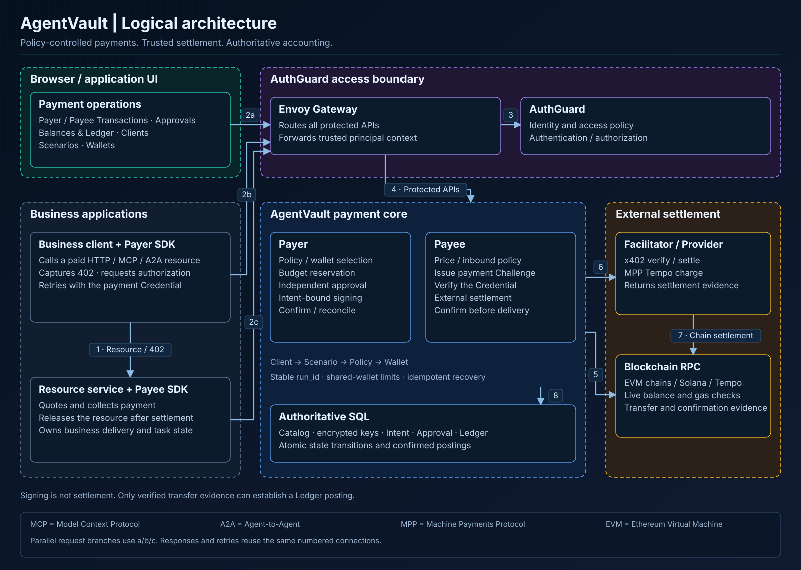
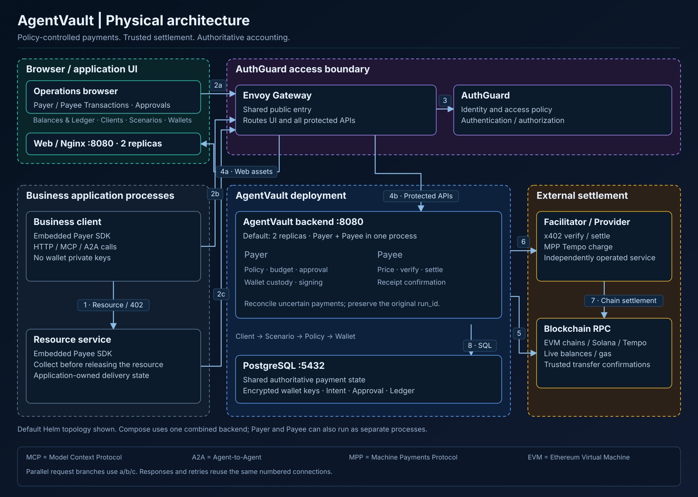

# AgentVault architecture overview

[中文](overview_ZH.md) · [Documentation index](../index.md)

AgentVault is bidirectional payment infrastructure for AI agents. Business applications embed Payer or Payee SDKs and call AgentVault over standard HTTP. AgentVault owns payment authorization, wallet custody, approvals, settlement verification, immutable accounting, and crash recovery. Applications retain ownership of workflows, resources, tasks, and delivery.

This overview describes implemented service and deployment boundaries. Protocol-specific contracts belong to the [SDK documentation](../../src/sdk/README.md).

## 1. Logical architecture and control boundaries

### Main call sequence

The diagrams use consecutive numbers. Letter suffixes mark parallel client or routing branches; responses and retries reuse the same connections.

| Step | Call |
|---|---|
| 1 | Business client requests a resource; the resource service returns a payment Challenge when needed. |
| 2a–2c | UI, Payer SDK, and Payee SDK submit their respective requests through Envoy Gateway. |
| 3 | Gateway calls AuthGuard for identity and access checks. |
| 4 | Gateway routes the protected API request to AgentVault. In the physical view, 4a serves Web assets and 4b routes backend APIs. |
| 5 | AgentVault checks live chain balances/gas and independently observes transfer evidence. |
| 6 | Payee invokes the external Facilitator/Provider to verify and settle a Credential. |
| 7 | The Provider executes or confirms the chain settlement. |
| 8 | AgentVault reads or atomically records authoritative payment state and confirmed Ledger effects in SQL. Authorization, approval, and recovery reuse this transaction boundary. |

| Boundary | Main responsibility |
|---|---|
| Browser / application UI | Payer Transactions, Payee Transactions, Approvals, Balances & Ledger, Clients, Scenarios, and Wallets. History is read-only; approvals and supported configuration writes use the same domain APIs. |
| AuthGuard | Identity and access checks. One Envoy Gateway routes Web assets and every registered protected API; one coarse AuthGuard block represents its identity services. |
| AgentVault | Payer authorization/signing, Payee pricing/settlement, shared budgets, authoritative state, and recovery. |
| Business applications | Embed Payer/Payee SDKs. They own resource delivery and task state. |
| External settlement | Facilitators, Providers, and configured chain RPC supply evidence outside AgentVault. |

Gateway forwards trusted principal context. AgentVault checks Client/Scenario ownership and payment policy rather than reimplementing identity management. AuthGuard can be explicitly disabled for an isolated trusted network; payment-domain checks remain active.

## 2. Core responsibilities

| Component | Responsibilities |
|---|---|
| [Payer](../../src/payer/) | Validate Scenario/Policy, select Wallet, reserve budget, request independent approval, sign constrained payment data, and verify outbound evidence. |
| [Payee](../../src/payee/) | Resolve Price, issue Challenge, validate Credential, invoke external settlement, and confirm payment before business delivery. |
| [Shared domain/state](../../src/core/) | Client/Scenario/Policy ownership, wallet custody and key versions, Intent/Approval/Ledger transactions, and idempotent recovery. |
| [Protocol adapters](../../src/protocol/) | Map x402/MPP payment semantics and obtain trusted chain evidence. |

[Payer/Payee SDKs](../../src/sdk/) run inside the integrating application, not as extra services. [The CLI](../../src/cmd/) composes the backend roles; [the Web application](../../web/) manages payment operations through the protected HTTP boundary.

## 3. Resources, authorization, and budgets

The ownership graph is **Client → Scenario → Policy → Wallet membership**. A Client owns many Scenarios; a Scenario owns many Policies; a Policy authorizes one or more Wallets. Explicit membership permits shared wallets.

| Resource | Meaning and invariant |
|---|---|
| Client | Registered application; `auth_principal` binds it to a trusted principal. |
| Scenario | Payment isolation boundary belonging to one Client; registration alone grants no spending authority. |
| Policy | Protocol/network/asset/origin/recipient restrictions, directional budgets, and approval rules. |
| Wallet | Managed externally owned account or external receiving address; shared wallets retain aggregate hard limits. |
| Price | Authoritative Payee quote bound to Scenario, inbound Policy, and eligible receiving Wallet. |
| Intent | Durable payment state, selected authorization facts, reservations, and recovery progress. |
| Approval | Independent administrator decision bound to an existing Intent and business Run. |
| Ledger | Append-only confirmed financial effects, corrected by explicit reversal entries. |

`run_id` identifies one logical operation, not an authorization identity. `UNIQUE(scenario_id, run_id)` returns the existing result for the same request fingerprint and rejects a changed request. Polling, approval, paid retries, evidence reporting, recovery, and application delivery retain that Run. Retries increase `attempt_no`; traces may change across attempts or restarts without creating another business correlation identifier.

Payer submits `scenario_id + run_id + original challenge`. The trusted principal determines Client ownership. The caller cannot choose Policy, Wallet, amount, asset, network, or recipient for signing; those facts come from the Challenge and persisted configuration.

Eligible Policy–Wallet memberships form a bounded pool. Selection separates direct authorization, approval-required, and rejected candidates, then prefers lower daily spent-plus-reserved usage with a deterministic request-hash tie-break. Matching Policies are alternatives, not intersecting restrictions. SQL locks recheck membership, key version, Policy snapshot, and both Scenario and shared-Wallet budgets. Once an Intent exists, retries do not silently switch Wallets. Authorization uses SQL membership/existence queries; catalog pagination serves presentation only.

Inbound and outbound limits are independent within the Policy budget unit. Inbound limits constrain inventory or business exposure. One-use approval grants add bounded headroom to one Intent; they neither rewrite long-term Policy nor bypass Wallet hard limits. Requesters cannot approve their own payments. Grant claims and recovery material bind Intent, request hash, amount, approver, and expiry, and are consumed atomically during reservation. Approval JWTs are internal Intent-bound proofs, not login tokens; durable state retains claim hashes and protected recovery material.

## 4. Payment and recovery flows

### Outbound: authorize and pay

1. The Payer SDK receives a payment Challenge from an HTTP, MCP, or supported A2A resource.
2. It retains one `run_id` and submits the original Challenge and Scenario to AgentVault.
3. Payer validates ownership and Challenge semantics, selects an eligible Wallet, and reserves directional budget in SQL. If needed, it persists Approval and waits for a permitted independent decision.
4. Before each signature, Payer rechecks lifecycle, authorization, key version, live chain balance, and gas. Protocol adapters create Intent-bound signing plans; arbitrary caller-provided digests are rejected.
5. The SDK retries the same resource operation with the Credential and reports the protocol payment response.
6. Trusted Provider/RPC evidence confirms transfer. Intent, Event, Ledger, and Outbox changes commit atomically. A signature or merchant-supplied receipt alone is not settlement.

### Inbound: collect before delivery

1. A resource handler embeds the Payee SDK and resolves authoritative Price.
2. Payee issues a unique expiring Challenge bound to Scenario, resource, amount, asset, and recipient, reserving inbound capacity.
3. Credential semantics and replay are checked; Payee calls the configured external Facilitator/Provider to verify and settle.
4. Only evidence matching network, token, decimals, amount, recipient, transaction effect, and confirmations permits durable settlement and Receipt.
5. The application releases the resource using its existing `run_id` and task/delivery store. Delivery failure after payment retries delivery, not charging.

Credential fingerprints are unique within each payment direction and cannot be redeemed against another resource or request. A deployment serving both sides can record one outbound and one inbound fact for the same external payment, preserving each wallet's accounting perspective.

External settlement and local SQL cannot share an atomic commit. Durable recovery evidence, idempotent provider calls, SQL leases, and Reconciliation converge uncertain outcomes. Recovery reads exact `(intent_id, event_type, attempt_no)` evidence, not a paginated audit view. SQL Outbox records deduplicate by destination, event type, and `run_id`. Each process has a unique lease owner; recovery workers compete for SQL leases, not broker subscriptions. No business message broker is required. The default CLI runs Reconciliation, approval expiry, and balance synchronization; it does not start a push-notification dispatcher. Outbox delivery is an explicit extension through `PaymentEventDispatcher` and `PaymentEventSink`; SDKs and administrators can query payment/approval state over HTTP.

## 5. Persistence and financial consistency

PostgreSQL or SQLite is the payment authority. The [migrations](../../migrations/) initialize canonical schema and version history transactionally. Startup neither replays initialization nor accepts an unknown version chain.

| Tables | Purpose |
|---|---|
| `pay_client`, `pay_scenario`, `pay_policy`, `pay_price` | Identity ownership, authorization configuration, and quotes. |
| `pay_wallet`, `wallet_key_version`, `pay_policy_wallet` | Wallet metadata, immutable encrypted key versions, hard limits, and membership. |
| `pay_scenario_approver`, `pay_approval` | Permitted approvers, Intent-bound decisions, and one-use grants. |
| `pay_intent`, `pay_event` | Payment state and append-only operational/recovery evidence. |
| `pay_ledger` | Confirmed effects, deduplication, and exact reversals. |
| `pay_outbox` | Durable delivery/recovery records committed with aggregate state. |
| `pay_wallet_balance` | Non-authoritative chain observations for operations. |
| `pay_schema_version` | Forward-only schema history. |

PostgreSQL uses ordered row locks, conditional updates, and SQL leases. SQLite uses `BEGIN IMMEDIATE` and transactional leases, with one AgentVault writer process. Shared PostgreSQL supports multiple replicas. Redis locks do not establish correctness.

Reservation, grant consumption, transitions, key-version changes, and accounting are explicit domain transactions. DDL constraints enforce static relationships and uniqueness; business triggers and stored procedures do not hide state transitions. Domain ports expose financial append/reversal operations, not arbitrary history updates. Credential isolation and controlled migrations are the operational boundary; arbitrary direct SQL writes are unsupported.

Ledger deduplicates by `(wallet_id, posting_key)`. Trusted `effect_ref` values distinguish principal, gas, refunds, and other effects of a transaction. Historical rows are not edited or deleted. Critical persistence failures fail closed: logs, cache, and client assertions cannot establish funds.

## 6. Protocol and application integration

| Binding | Implemented scope |
|---|---|
| x402 v2 / EVM | Exact token payments and EIP-3009 Intent-bound authorization. |
| x402 v2 / Solana | Supported SPL-token exact-payment profiles with configured chain, fee payer, and receipt verification. |
| MPP / Tempo | `charge` using constrained type-0x76 signing and an external settlement provider. |
| HTTP / MCP | Challenge, Credential, paid retry, and protocol-specific Receipt handling. |
| A2A | Explicitly enabled, non-streaming A2A 0.3 JSON-RPC `message/send`, using each payment protocol's own metadata/extension contract. |

MPP session, split, fee sponsorship, machine-token, and delegated-key modes remain unsupported. Automatic A2A payment does not claim streaming, A2A 1.0, or nested AP2 support. Conflicting or unsupported wire representations are rejected rather than guessed.

Challenges select neither provider endpoints nor chain RPC: both come from operator configuration. Adapters use fixed authorities, bounded responses/timeouts, and constrained redirects. x402 absolute expiry survives approval and retries. Receipt reports are evidence-discovery inputs, not accounting authority. SDKs preserve business authentication, prevent cross-origin Credential forwarding, and remove payment metadata before invoking business handlers.

AgentVault does not deploy business A2A or MCP servers. Integrating applications own these servers and embed Payee SDKs to gate delivery; outbound clients embed Payer SDKs. See the [SDK contract](../../src/sdk/README.md#a2a-automatic-payments) for language adapters and wire examples.

## 7. Custody, configuration, and management surfaces

Managed wallet keys use AES-256-GCM envelope encryption and immutable SQL key versions. `agentvault.key_management` references key-encryption keys (KEKs), not EOA private keys. Only Payer opens custody for constrained signing; Payee uses public wallet metadata. Retirement or compromise does not erase history or permit unsigned work to keep using retired keys.

Browser import supports secp256k1 EOA keys and first obtains a short-lived identity-bound RSA-3072 public-key session. Web Crypto encrypts the 32-byte private key with fixed RSA-OAEP/SHA-256 parameters and a wallet/session-bound label. The server atomically consumes the session, briefly decrypts the key, and delegates to existing KEK-protected SQL custody. The temporary private key is recovery-encrypted in TTL cache, not stored as a durable wallet key. Plaintext is excluded from browser state, URLs, logs, and JSON requests. HTTPS remains necessary for authentic page and public-key distribution.

Dashboard and console share domain ports. Transaction/Event/Ledger history and Client identity bindings are read-only in the UI; controlled resource import owns identity/catalog registration. Scenario creation atomically writes Scenario, initial Policy, and selected Wallet membership. Wallet UI/console supports creation and public metadata reads, not private-key export or arbitrary key lifecycle operations. Price writes check revisions, preserve immutable scope/creation identity, and cannot delete referenced history.

Configuration uses defaults < native YAML < `AGENTVAULT__...` environment overrides. Payer and Payee profiles are independently enabled. Secrets are supplied through references, not embedded in SDK configuration; deployment details belong to the [Helm guide](../../deploy/helm/agentvault/README.md).

## 8. Physical deployment and operations

The diagram depicts default Helm deployment: separate Web replicas and replicated **combined-role** backends. Payer and Payee are module/process roles, not two mandatory deployments. `agentvault serve --role payer` and `--role payee` support independent processes with the same HTTP contract. Compose defaults to one combined backend.

| Component | Deployment behavior |
|---|---|
| Envoy Gateway / AuthGuard | Shared protected entry. Configure production edge TLS; Compose development entry is HTTP `:8080`. |
| Web | Separate production Nginx image on internal `8080`; the browser uses same-origin APIs through Gateway. |
| Backend | Default Helm deployment has two combined Payer/Payee replicas; business and administrative APIs use `8080`. |
| PostgreSQL | Shared authoritative database for backend replicas; encrypted wallet keys, payment state, and Ledger remain durable. SQLite is a single-process alternative. |
| Facilitator / Provider / chain nodes | Independently operated settlement services, selected by operator configuration rather than untrusted Challenges. |

Cache, Secret provisioning, health probes, and telemetry are supporting deployment concerns. Their configuration and optional external endpoints are covered by the [Docker](../../deploy/docker/README.md) and [Helm](../../deploy/helm/agentvault/README.md) guides. They are intentionally not expanded into additional architecture regions.

## 9. Verification and related documentation

The [MarketPulse use case](../../use-cases/marketpulse-feed-subscription/README.md) covers five Payer and five Payee SDKs: 25 isolated full HTTP combinations or four Rust/Go combinations. Each case cross-checks selected wallets, SQL Intent/Ledger/Receipt, chain balances, settlement effects, gas, and trace parentage. Separate Solana, Tempo, and A2A scenarios establish their own evidence, not proof of every profile through a single scenario.

Docker and Kubernetes CI also run `live-wallet`: Chromium loads the **production Web container**, calls live APIs through Nginx without browser API interception, and checks payment views, filters, balances, approvals, Client ownership, encrypted wallet custody, and atomic Scenario creation, with screenshots and SQL assertions. The optional `web` scenario uses immutable-report-derived fixtures for larger presentation/pagination checks; it is not described as a live production database test.

- [SDKs and A2A bindings](../../src/sdk/README.md)
- [Docker deployment](../../deploy/docker/README.md)
- [Helm deployment and Secret bootstrap](../../deploy/helm/agentvault/README.md)
- [End-to-end scenarios and evidence](../../use-cases/marketpulse-feed-subscription/README.md)

The diagram footer expands domain-specific acronyms only. EOA in the custody discussion means externally owned account.
