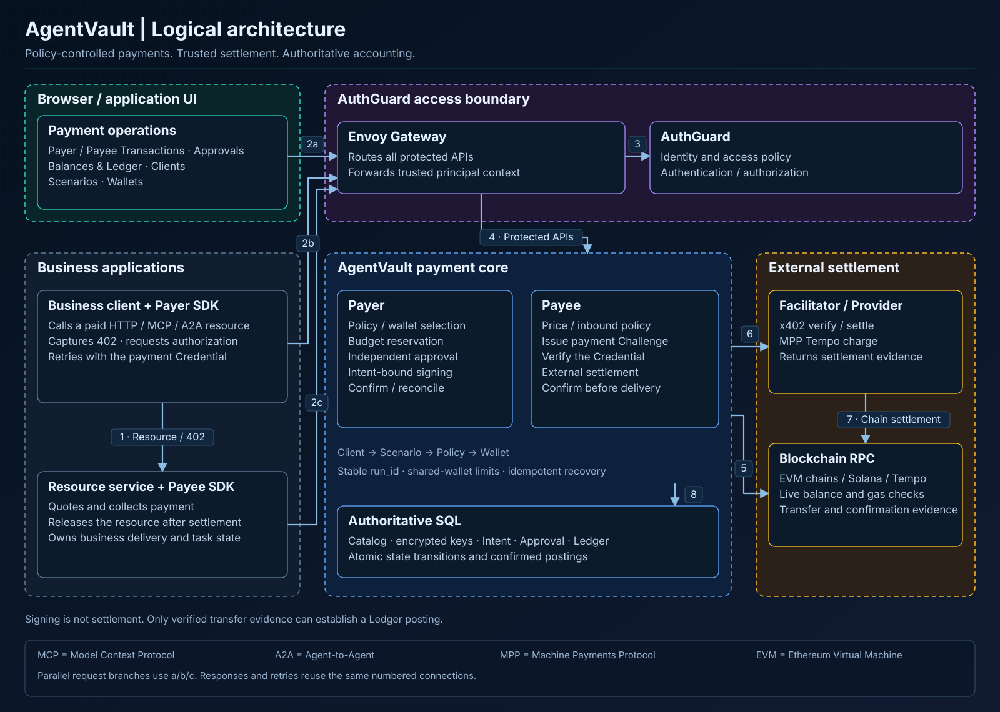
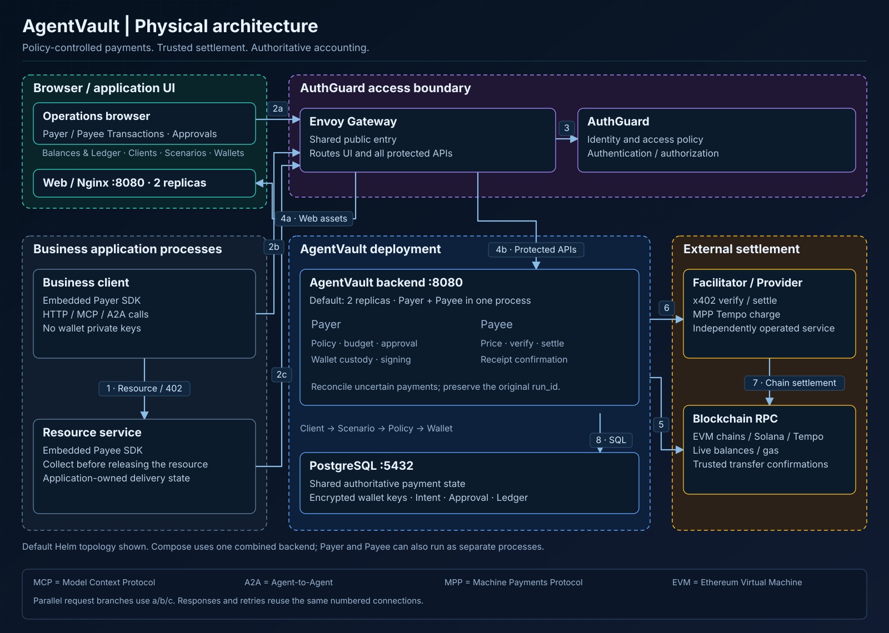

# AgentVault 架构总览

[English](overview.md) · [支付架构白皮书](AgentVault-Payment-Architecture-Whitepaper_ZH.md)

AgentVault 为业务应用提供支付授权与结算边界。Payer 选择并授权钱包使用，Payee 确认收款后才允许业务应用交付资源；AuthGuard 负责身份和 API 访问，SQL 负责持久支付状态。

[正式白皮书](AgentVault-Payment-Architecture-Whitepaper_ZH.md) 是架构参考，定义职责、接口、资金不变量、故障处理与实现范围。

## 逻辑架构

按图中从上到下的顺序阅读：

| 步骤 | 目的 |
|---|---|
| 1–3 | 共享受保护的管理/访问入口；每次 SDK 调用 AgentVault 都重复相同访问检查。 |
| 4–6 | 请求资源并取得权威支付 Challenge。 |
| 7–10 | 授权原始 Challenge、预留预算、检查实时资金，返回签名 Credential。 |
| 11–17 | 携 Credential 重试资源请求，确认入站结算并入账，然后交付资源。 |
| 18–20 | 上报支付响应，独立核验转账，完成付款方会计记录。 |

预算预留先于签名，入站确认先于交付，付款方入账必须取得独立证据，不能只相信商户声明。[编号调用规范](AgentVault-Payment-Architecture-Whitepaper_ZH.md#numbered-calls) 给出每步的输入、结果和状态影响。

## 物理部署

默认 Helm 部署包含独立 Web 副本和两个组合角色后端副本，共用 PostgreSQL。Payer/Payee 可分别运行，并不代表另建业务 A2A/MCP Server；Facilitator、Provider 和链 RPC 始终独立于 AgentVault。详见[部署模式](AgentVault-Payment-Architecture-Whitepaper_ZH.md#deployment)。

## 架构保证

- 可信 Principal → Client → Scenario → Policy → Wallet membership 决定权限；调用方不能任意选择签名事实。
- SQL 事务强制执行预算、一次性审批、不可变会计记录和幂等恢复。
- 私钥由 AgentVault 托管，业务 SDK 只取得受约束支付 Credential。
- 业务应用保留任务和交付状态，包括确认付款后的交付重试。

[SDK 接入](../../src/sdk/README.md) · [Docker](../../deploy/docker/README.md) · [Helm](../../deploy/helm/agentvault/README.md) · [端到端验证](../../use-cases/marketpulse-feed-subscription/README_CN.md)
